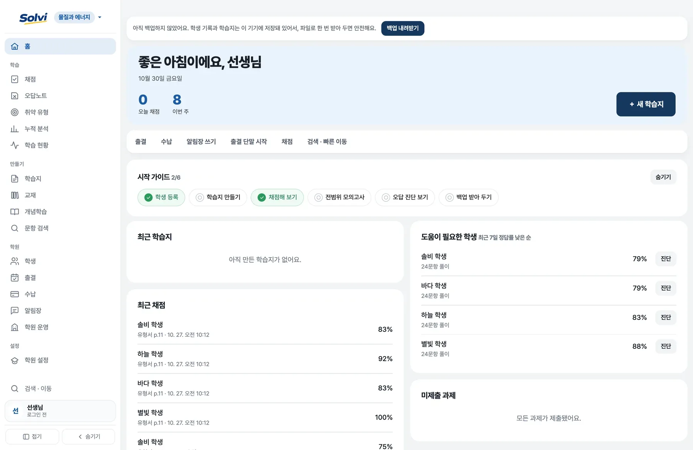
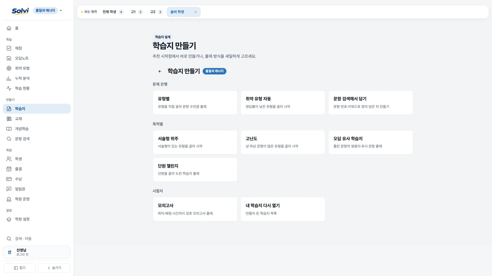
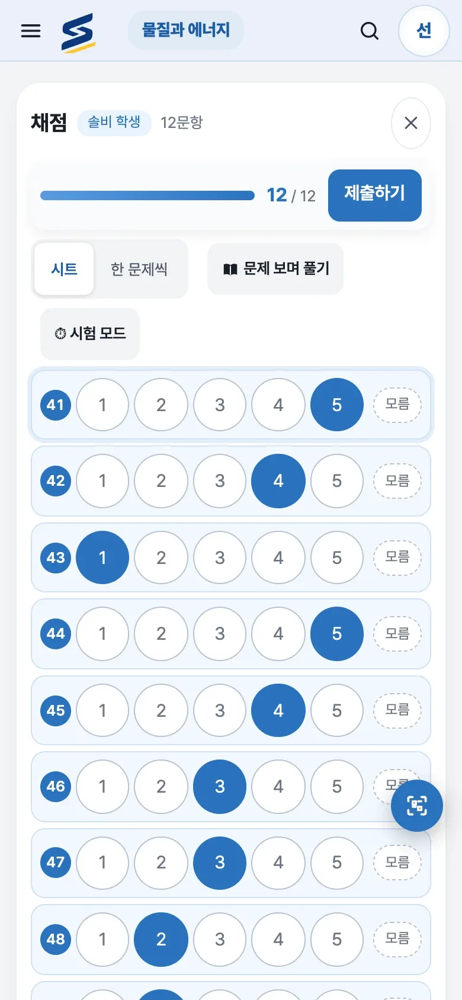
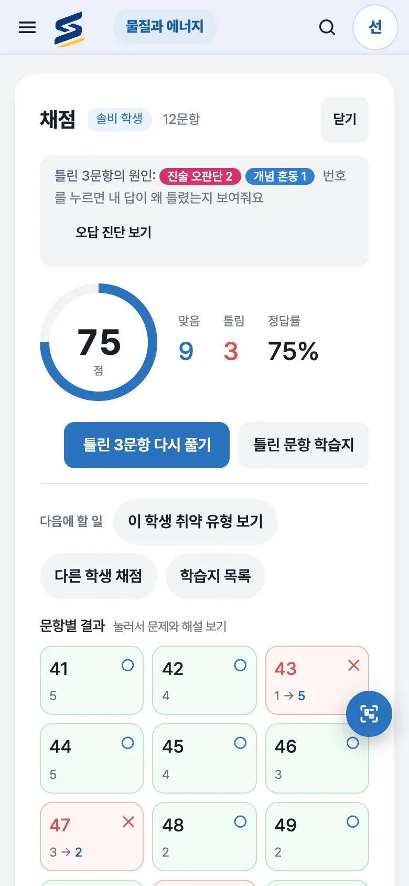
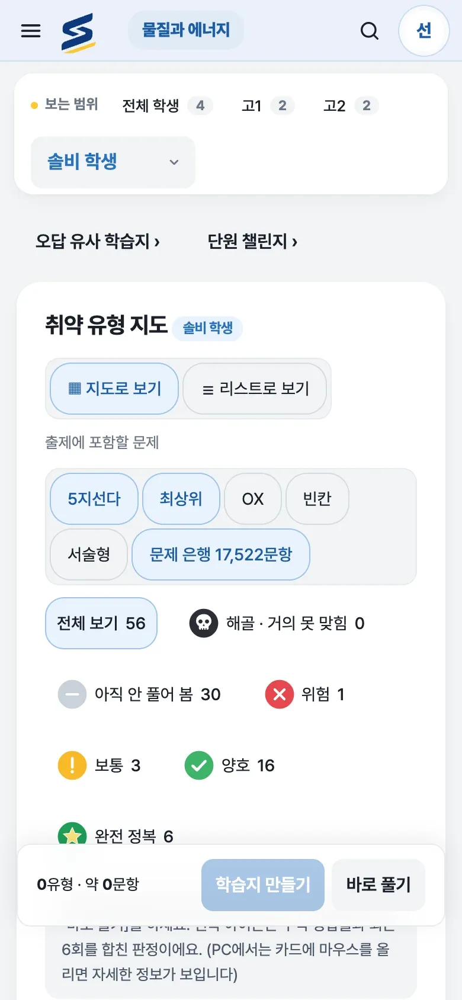
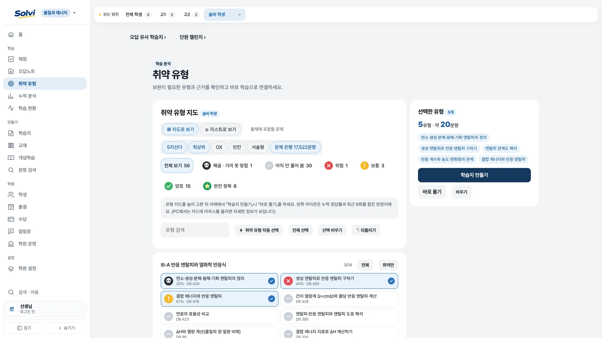
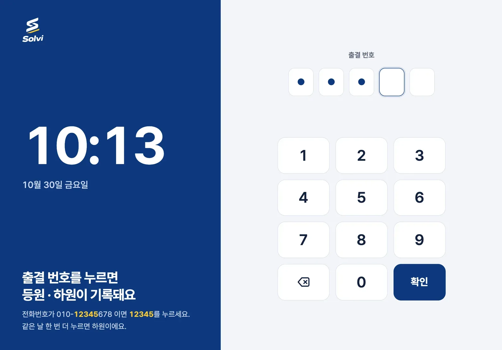
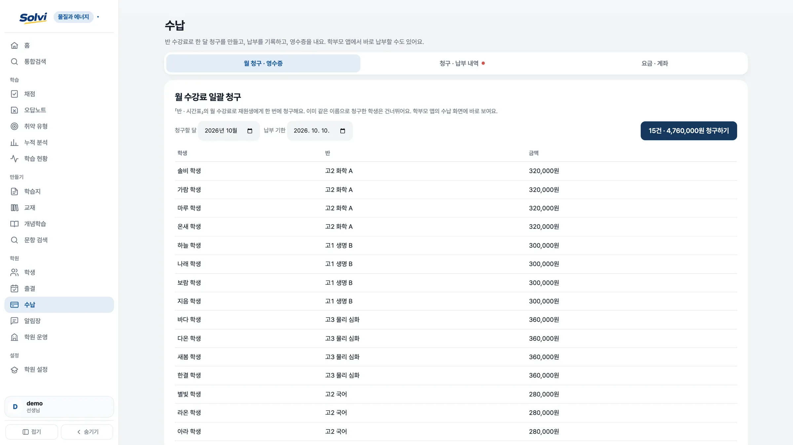
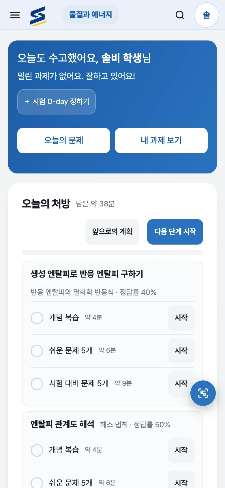
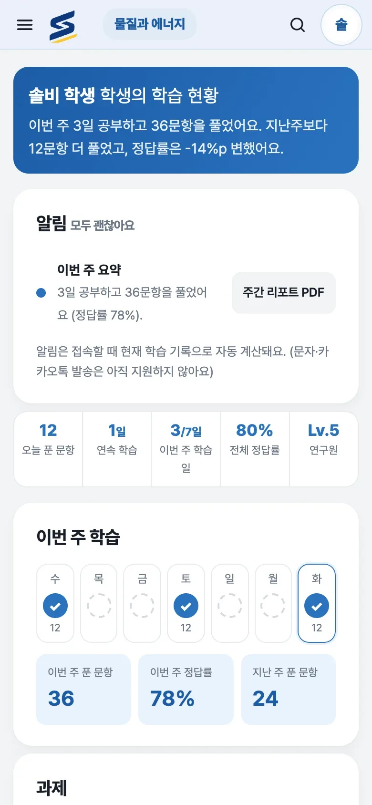

# Solvi (솔비)

**고등 과학 · 국어 문제은행으로 학습지를 만들고, 종이에 찍힌 QR로 채점하고, 학생마다 틀리는 유형을 찾아 다음 학습지를 다시 만드는 웹앱입니다.**
학원 운영(원생 · 반 · 출결 · 수납 · 상담 · 보강 · 알림장)까지 같은 데이터베이스에서 처리합니다.

- 서비스: **https://solvi.win** (로그인 전 소개 페이지 → 선생님 · 학생 · 학부모 로그인)
- 정보 과제 연구(꿈두레) 개인 프로젝트 · 1학기 꿈두레 「데이터베이스 프로그래밍」의 후속 연구
- 발표 자료 · ERD · 실험 스크립트: [`docs/research/`](docs/research/README.md)



## 한눈에 보기

| 항목 | 값 (2026-11-27 저장소 집계) |
|---|---|
| 문제은행 문항 | **76,645문항** — 물질과 에너지 30,411 · 인공지능 수학 24,479 · 화법과 언어 11,950 · 세포와 물질대사 5,305 · 역학과 에너지 4,500 |
| 문항 유형 | 289개(유형 이름 기준), 모든 문항에 고유 코드(예: `G-cm05-0002`) |
| 교재 문항 | 1,882문항(개념 · OX · 빈칸 · 기초 · 서술형) |
| 데이터베이스 | PostgreSQL 표 36개 · 외래키 51개 · 행 수준 보안 정책 76개 · SQL 함수 92개 (`setup.sql`, `supabase/sql_*.sql`) |
| 문항 자동 검수 | 화법과 언어 13,258 · 물질과 에너지 13,943 · 인공지능 수학 14,400문항, 정답 · 해설 오류 0건 |
| 자동 시험 | `npm test` — 정적 파싱, UI 계약, DB(PGlite), 인쇄, 국어, 행정, 소개 페이지, 앱 행동 회귀(Playwright) |
| 서버 | Supabase → **라즈베리파이 5**(Docker: PostgreSQL · PostgREST · GoTrue · Caddy)로 이식해 운영 |

## 학습 순환: 출제 → 풀이 → 채점 → 진단 → 다시 출제

```
 문제은행 ──▶ 학습지 · 교재 · 모의고사 ──▶ 종이 · 태블릿에서 풀이
    ▲                                         │  쪽 QR · 학습지 번호 · OMR
    │                                         ▼
 오답 · 쌍둥이 학습지 ◀── 취약 유형 진단 ◀── 채점 기록(DB attempts)
```

모든 기능은 이 한 바퀴를 끊기지 않게 돌리는 데 맞춰져 있습니다. 채점 한 번이 DB에 한 행으로 남고, 그 기록이 유형 지도 · 오늘의 처방 · 다음 학습지 · 학부모 알림으로 그대로 이어집니다.

## 기능 소개

### 1. 출제 — 학습지 · 교재 · 모의고사

| 기능 | 설명 |
|---|---|
| 학습지 만들기(3단계) | ① 단원 · 유형 · 문항 수 · 난이도 비율 → ② 문항 확인 · 바꾸기 · 순서 끌기 → ③ 디자인(수능형 · 학교 지필 · 평가원 등) · 출력. 출제 순서는 **오답 → 쌍둥이 → 새 문제** |
| 취약 유형 자동 선택 | 유형 지도에서 해골 · 빨강 · 노랑으로 표시된 유형을 한 번에 골라 맞춤 학습지 |
| 교재 만들기 | 개념 · OX · 빈칸 · 기초 5지선다 · 유형 N제 · 서술형을 원하는 순서로 묶어 책으로. **쪽마다 QR**이 찍혀 그 쪽만 바로 채점 |
| 모의고사 | 평가원식 표지 · 배점 · 회차 관리 · 이전 회차 문제 제외 · 화면에서 제한 시간 시험 |
| A/B형 · 쌍둥이 | 다른 문제 또는 같은 문제의 선지 순서만 바꾼 A/B형, 학교 기출 경향대로 새로 출제 |
| 출력 | A4 인쇄(PC) · A4 PDF 저장(태블릿 · 휴대폰) · **편집 가능한 HWPX** 내려받기 |
| 문항 검색 | 자연어(`엔탈피 어려운 계산`) · 해시태그(`#상 #OX`) · 쪽수 · 문항 코드 검색 |



### 2. 채점 — QR · 번호 · OMR

| 기능 | 설명 |
|---|---|
| 쪽 QR 채점 | 휴대폰 카메라로 학습지 · 교재 쪽의 QR을 찍으면 그 쪽 문항의 OMR이 열림 |
| 번호 채점 | QR 대신 학습지 번호(예: `4774-7515`)를 입력해도 같은 채점 화면 |
| OMR 답안지 사진 판독 | 평가원식 OMR 사진의 빨간 채널을 읽어 붉은 인쇄는 무시하고 연필 자국만 판독 |
| 패드 필기 채점 | 태블릿에서 펜슬로 풀고 바로 자동 채점 |
| 서술형 · 수식 답 | 정답(수식 · 화학 반응식)을 보고 스스로 채점(맞았어요 / 틀렸어요) |
| 쪽 단위 채점 | 148문항짜리 문항 모음도 「몇 쪽을 채점할까요?」 바퀴로 한 쪽씩 |
| 제출 잠금 | 한 번 제출한 학습지는 선생님이 초기화하기 전까지 다시 제출 불가 |
| 오프라인 채점 | 연결이 끊겨도 임시 저장했다가 연결되면 자동 제출 |

<p>



</p>

### 3. 진단 — 취약 유형 지도와 처방

| 기능 | 설명 |
|---|---|
| 취약 유형 지도 | 유형마다 누적 정답률 + 최근 6회를 합쳐 **해골 · 위험 · 보통 · 양호 · 완전 정복**으로 칠함 |
| 반 × 유형 지도 | 반 전체가 어느 유형에서 막히는지 한 화면에 |
| 오답 원인 진단 | 학생이 고른 선지를 해설과 대조해 「개념 혼동 · 발문 혼동 · 진술 오판단 · 성급한 풀이」로 분류 |
| 오늘의 처방 | 학생 홈에 「개념 복습 → 쉬운 문제 → 시험 대비 문제」 순서의 오늘 할 일과 예상 시간 |
| 오늘의 5문제 · D-day | 1 · 3 · 7 · 14 · 30일 간격 복습, 시험까지 남은 날과 하루 권장량 |
| 학습지 결과 분석 | 응시자 평균 · 점수 분포 · 문항별 정답률, 낮은 문항으로 바로 오답 학습지 |



### 4. 개념학습

개념 정리 → OX → 빈칸 → 기초 5지선다 순서로 단원을 공부하고, 취약 유형과 연결된 개념으로 바로 이동합니다. 시험 10분 전 요약 노트와 A4 개념 인쇄를 지원합니다.

### 5. 학원 운영

| 기능 | 설명 |
|---|---|
| 원생 · 반 | 반 시간표 · 수강료 · 담당 강사, 원생 상세(학습 · 출결 · 수납 · 상담을 한 화면에) |
| **태블릿 출결 단말** | 학원 입구 태블릿에서 학생이 PIN으로 등원 · 하원 → 학부모 앱에서 바로 확인 |
| **수납 · 토스페이먼츠** | 월 청구서 자동 생성, 학부모 앱에서 카드 결제(Toss Payments v2), 서버 함수가 결제 승인 확인 |
| 상담 · 보강 · 알림장 | 상담 기록 · 예약, 결석 보강 배정, 반별 알림장 |
| 반복 업무 | 매주 · 매월 할 일과 처리 기록, 운영 표가 바뀔 때마다 감사 기록(`ops_audit`) |
| 역할 | 원장 · 강사 · 행정 직원 권한을 DB 정책으로 분리 |

<p>


</p>

### 6. 학생 · 학부모 앱

- **학생**: 선생님 코드로 가입 신청 → 선생님 승인. 오늘의 처방 · 과제 · 오답 메모 · 풀이 사진 · 주간 목표 · 배지, 문항 코드 검색.
- **학부모**: 학생당 최대 5개의 보기 전용 계정으로 학습량 · 과제 · 출결 · 수납 · 알림장 확인, 카드 결제.
- **앱처럼 쓰기**: 홈 화면에 추가(PWA) · 오프라인 열기 · 패스키 로그인 · 자동 로그인.

<p>


</p>

## 기술 구성

| 층 | 사용 기술 |
|---|---|
| 화면 | 빌드 없는 정적 HTML · CSS · JavaScript (`index.html`, `books.js`, `lazy/*.js`, `styles/*.css`), 서비스 워커(`sw.js`) |
| 문제은행 | 과목 폴더의 정적 JSON(`bank/` · `cm/` · `ph/` · `hl/` · `aim/`), 필요한 유형만 늦게 불러오기 |
| 데이터베이스 | PostgreSQL + 행 수준 보안(RLS) + SQL 함수(`st_submit` · `ws_submit` 등), PostgREST API |
| 인증 | GoTrue(이메일), 학생 · 학부모 아이디 계정(pgcrypto 해시), 패스키(WebAuthn) |
| 서버 | 라즈베리파이 5 + Docker Compose + Caddy(HTTPS) — [`pi/README.md`](pi/README.md) |
| 결제 | Toss Payments v2 + 결제 승인 서버 함수(`supabase/functions/toss-confirm`) |
| 배포 | GitHub Pages(`solvi.win`) |
| 시험 | Playwright(Chromium) · PGlite(메모리 PostgreSQL) · 파이썬 문항 검수기 |

설계 원칙: 문항 본문은 바뀌지 않으므로 DB가 아니라 정적 JSON에 두고 **문항 코드로 참조**합니다. DB에는 학생 · 학습지 · 채점 기록처럼 바뀌는 데이터만 저장해, 7만여 문항을 서버에서 매번 내려받지 않고 브라우저 캐시 · 오프라인 저장을 씁니다.

## 데이터베이스

| 영역 | 주요 표 |
|---|---|
| 학습 | `students`, `attempts`(채점 1회 = 1행, 문항별 결과는 JSONB), `worksheets`, `assignments`, `wrong_notes`, `q_reports` |
| 계정 · 가입 | `teacher_settings`, `teacher_join`, `signup_requests`, `passkeys`, `st_tokens` |
| 학원 운영 | `classes`, `class_members`, `attendance`, `fees`, `counsels`, `makeups`, `ops_tasks`, `ops_audit`, `academy_members` |
| 학부모 | `parent_accounts`, `parent_notices`, `pa_tokens` |

모든 표가 교사 계정(`user_id`)을 외래키로 갖고 `auth.uid() = user_id` 정책으로 학원별 데이터를 DB 단에서 분리합니다. 표 36개의 ERD(Chen 표기)는 [`docs/research/img/erd/`](docs/research/img/erd/)에 있습니다.

## 실제 사용과 개선

- **2026-11-11** 인스타그램에 소개 · 사용 신청 방법 · 사용 꿀팁 카드뉴스(25장)를 올리고, 9개 고등학교 학생 약 50명이 실제로 가입해 사용했습니다.
- 테스트 기간에 발견한 문제(회원가입 화면이 안 뜸, 서술형 · 수식 답 입력 불가, 버튼 반응 없음처럼 보임, 긴 문항 모음 채점 불편 등)를 바로 고쳤습니다. 목록은 [`WORKLOG.md`](WORKLOG.md)와 발표 자료 19번 슬라이드에 있습니다.

## 문서

| 문서 | 내용 |
|---|---|
| [`PRODUCT.md`](PRODUCT.md) | 제품 맥락 |
| [`AGENTS.md`](AGENTS.md) | 개발 규칙 · 검증 명령 |
| [`WORKLOG.md`](WORKLOG.md) | 작업 기록(최신이 위) |
| [`docs/research/`](docs/research/README.md) | 발표 자료 · ERD · 실험 스크립트 |
| [`docs/verification/`](docs/verification/) | 검증 기록 |
| [`docs/README-history.md`](docs/README-history.md) | 예전 README의 기능 설명 · 날짜별 변경 기록 |

> 화면 캡처의 학생 이름과 기록은 모두 예시 데이터입니다.

---

# 개발 참고

## 화법과 언어(hl) 생성기

- **자료**: 모의고사 12문항(`src_mock.py`), 「국어의 원리」(nn.pdf) 기출 연습 60문항(`src_nn1~3.py`)과 확인 문제 빈칸 70개(`src_short.py`), 학교 교재의 기출 29문항·출판사 문제·O/X·서술형(`src_school.py`)을 교재 문항으로 담았습니다. 원문을 그대로 옮기지 않은 개념·해설은 직접 쓴 것입니다.
- **개념서**: `tools/hl/concept_*.py`(절 50개). 설명은 처음 배우는 사람 기준으로 풀어 썼고, 표·예문·시험 포인트·흔한 혼동을 함께 둡니다.
- **문제 은행**: 유형(`tools/hl/outline.py`의 99개)마다 생성기(`types_*.py`)가 문제를 만들어 `hlNNN.json`으로 냅니다. 수능형·내신형·융합형을 하·중·상·최로 나누고, 같은 문제는 걸러 냅니다. 코드는 `G-hlNNN-NNNN`입니다.
- **문항 코드**: 교재 문항은 `H26-` `N-` `KS-` `P-` `KV-`(OX) `KL-`(빈칸) `KP11-…`(제작 문항) `KR-`(최상위) `W-`(서술형)입니다. 물리 과목 코드와 겹치지 않도록 `K` 접두어를 씁니다(겹치면 앱이 뒤에 불러온 쪽을 버립니다).
- **주교재(필기용)**: 교재 탭의 「주교재 (필기용)」(책 번호 `hl-hs`(화법편) · `hl-hg`(언어편: 문법·중세 국어·맞춤법·종합; 예전 `hl-hc`·`hl-ho` 번호도 각각 화법편·언어편으로 열림). 소단원마다 OX → 빈칸 → 5지선다(쉬운 문제부터) 순. 표지 디자인과 교재 색은 읽기·인쇄 도구 막대에서 바꿉니다(개념 문체는 평서형, 표 머리줄은 연한 색, 옛한글은 KoPub 돋움 부분 서브셋 `fonts/KoPubDotum-*.subset.woff2`). 필기 쪽은 화법.pdf(2026 모의고사) 지문 옆에만 두고, 수능특강 지문(`EW*`)과 제작 지문 세트(`KJ-*`, `tools/hl/src_set.py`)는 필기 쪽 없이 모의고사처럼 지문+문항을 2단으로 이어서 싣습니다(지문 발문의 [1~3]은 이 책의 문항 번호로 바뀜). 화법편에는 대본을 잘라 낸 제작 문항 대신 온전한 지문만 실립니다. 문제는 5지선다·OX·빈칸을 구분 없이 이어서 2단이며 장문 문항도 1단으로 넓게 깔지 않고 2단으로 둡니다. 화법 개념은 절마다 핵심 표·혼동 주의만 남겼습니다(`concept_sp.py`의 `TRIM`). 지문·절마다 OX·빈칸 3~6문항이 딸립니다). **왼쪽(짝수) 쪽에 본문, 오른쪽(홀수) 쪽은 필기 공간**이고, 개념(절)마다 뒤에 줄 노트·모눈 노트 쪽이 붙습니다. 화법 지문은 필기하기 좋게 자간과 줄 간격을 넓혔고, 지문 뒤에 **원본 문제 → 변형(평가원 난이도) → 변형(내신형) → 개념 체크(OX·빈칸)** 순으로 이어집니다. 인쇄 창에서 오른쪽 필기 쪽(빈 쪽·줄·모눈), 개념 뒤 노트 쪽(없음·줄·모눈), 문제 쪽 뒤 필기 쪽, 변형 문항 수를 바꿀 수 있습니다. 변형 문항은 `hl/index.json`의 절·문체 정보로 같은 절에서 고르고, 한 책 안에서 같은 문항을 되풀이하지 않습니다.
- **다시 만들기**: `python3 tools/hl/make_hl.py` 후 `node tools/measure_books.js hl`(서버가 8765에서 켜져 있어야 함)로 교재 쪽 나눔용 높이표를 갱신합니다.

## 폴더 구조

```
index.html        앱 전체 (HTML/CSS/JS)
bank/             물질과 에너지 문제 은행 (유형별 JSON, 필요할 때만 불러옴)
cm/               세포와 물질대사: data.json(교재), 문제 은행 JSON, fig/(그림)
ph/               역학과 에너지: data.json(교재), concept.json(개념서), 문제 은행 JSON(유형별, 그림은 SVG로 문항에 포함)
tools/ph/          역학과 에너지 문제 생성기(파이썬). `python3 tools/ph/make_ph.py` 로 ph/ 전체를 다시 만듭니다(AUTHORS.md 참고)
hl/               화법과 언어: data.json(교재), concept.json(개념서), index.json, hlNNN.json(유형별 문제 은행)
tools/hl/          화법과 언어 생성기(파이썬). `python3 tools/hl/make_hl.py` 로 hl/ 전체를 다시 만듭니다(`--skip-bank` 는 은행을 건너뜀)
fig/              물질과 에너지 교재 그림
fonts/ lib/       글꼴, QR 스캔 라이브러리
setup.sql         Supabase 테이블 생성 SQL (온라인 저장을 쓸 때)
server.py         내 컴퓨터에서만 쓰는 간이 서버
```

## 실행

### 내 컴퓨터에서
```bash
python3 server.py        # http://localhost:8765
```
기록은 브라우저와 `results.json`에 저장됩니다.

### GitHub Pages로 배포
1. 저장소 **Settings → Pages**에서 Source를 `Deploy from a branch`, Branch를 `main` / `(root)`로 설정합니다.
2. `main`에 변경 사항이 반영되면 1~2분 뒤 사이트가 갱신됩니다.

### 온라인 저장(선택)
여러 기기에서 학생·기록·학습지를 함께 쓰려면 Supabase를 연결합니다.
1. Supabase 프로젝트를 만들고 SQL Editor에서 `setup.sql`을 실행합니다.
2. `index.html`의 `loadCfg()` 안 `url`, `key`(공개 anon 키), `pub`(배포 주소)를 본인 값으로 바꿉니다.

## 문제 은행 데이터 형식

`bank/index.json`, `cm/index.json`, `ph/index.json`이 유형(태그) 목록이고, 태그마다 `<태그>.json` 배열이 있습니다.

```json
{ "code": "G-znheat01-0001", "no": 1, "set": "bank", "sub": "Ⅲ-A", "subname": "반응 엔탈피와 열화학 반응식",
  "type": "ΔH와 열량 계산(물질의 양·질량 비례)", "ans": "3", "lv": "중", "fam": "heat",
  "q": "<div class=\"q\">…</div>", "exp": "<div class=\"sol\">…</div>" }
```

- `set`: `mc`(5지선다) `top`(최상위) `ox` `blank`(빈칸) `essay`(서술형) `bank`(변형 은행)
- `lv`: 하 / 중 / 상 / 최, `fam`: 같은 틀의 변형 묶음(쌍둥이 문제 추출에 사용)
- 코드 규칙은 `G-<태그>-<번호>`이며 태그 이름에 해당하는 JSON이 있으면 자동으로 불러옵니다.
- 새 태그를 추가하면 해당 폴더의 `index.json`에 `{label, sub, subname, n, lv}`를 함께 등록하세요.

## 업데이트(수정 반영) 방법

```bash
git add -A
git commit -m "변경 내용"
git push origin <브랜치>
```
작업 브랜치에서 푸시한 뒤 GitHub에서 **Pull Request → Merge**로 `main`에 합치면 배포 주소에 반영됩니다.
브랜치에서 바로 `main`으로 합치려면 `git checkout main && git merge <브랜치> && git push origin main`.

## 데이터 보관 · 초기화

- 기본적으로 브라우저(localStorage)에 자동 저장되며, 헤더의 💾 표시로 마지막 저장 시각을 볼 수 있습니다.
- 설정(⚙) → **백업 내려받기/불러오기**로 데이터를 옮길 수 있습니다.
- 설정(⚙) → **전체 초기화**는 되돌릴 수 없습니다. 먼저 백업하세요.

- **내 교재(직접 만들기)**: 교재 탭 > 「교재 만들기」에서 이름·부제, 종합 / 개념 양치기(OX·빈칸) / 특정 부분 양치기 / 직전 대비 교재 / 전범위 모의고사(최대 20회, 카드·리스트 보기, 회차별 문제지·해설 인쇄)를 고를 수 있습니다. 예전 「모의고사」 탭은 전범위 모의고사 화면의 「직접 구성」으로 합쳤습니다. 책 정의는 이 기기 localStorage(`omr_books_v1`)에 저장되고, 쪽 QR(`#bk=me-xb…:쪽`)에 구성이 들어 있어 다른 기기에서도 채점됩니다.

- **데이터 파일**: 물질과 에너지 기본 문항은 `bank/data.js`로 분리했습니다(index.html에서 `<script>`로 먼저 불러옴). 문항을 고칠 때는 이 파일을 수정하세요.
- **화면 테마**: 설정에서 라이트 / 다크(실험)를 고를 수 있습니다. 색은 `:root`의 토큰(`--surface`, `--l2`, `--sf1`, `--sf2`, `--m2` …)과 `html[data-theme=dark]` 재정의로 관리합니다.

## 패스키 로그인 · 자동 로그인

- **자동 로그인**: 로그인 화면의 「자동 로그인」(기본 켬)이 켜져 있으면 이 기기에서 로그인 상태가 유지됩니다. 끄면 탭을 닫을 때 로그아웃됩니다. 학생은 비밀번호 대신 서버가 발급한 토큰(90일, 해시로 저장)만 기기에 저장되고, 로그아웃하거나 선생님이 비밀번호를 다시 발급하면 무효화됩니다.
- **패스키 로그인**: 지문·얼굴·기기 암호로 비밀번호 없이 로그인합니다. 선생님은 로그인한 상태에서 설정(⚙)의 「이 기기에 패스키 등록」, 학생도 로그인한 상태에서 설정에서 등록합니다. 등록한 뒤에는 로그인 화면의 「패스키로 로그인」을 누르면 됩니다.
- **서버 설정(한 번만)**: 패스키는 서버가 서명을 검증해야 하므로 Supabase Edge Function이 필요합니다.
  1. Supabase SQL Editor에서 `setup.sql`을 다시 실행합니다(맨 아래 10번 항목: passkeys·st_tokens 테이블과 학생 토큰 인증).
  2. `supabase functions deploy passkey --no-verify-jwt` (게시 가능 키 `sb_publishable_…`는 JWT가 아니라서 `--no-verify-jwt`가 필요합니다. 함수가 직접 인증을 확인합니다.)
  3. `supabase secrets set SITE_URL=https://solvi.win` (사이트 주소, 경로 없이. 커스텀 도메인을 쓰면 그 주소)
  - 코드: `supabase/functions/passkey/` (`handler.js`가 검증 로직, `index.ts`가 Supabase 연결). 사이트 도메인이 바뀌면 패스키를 다시 등록해야 합니다.
  - SQL을 아직 적용하지 않은 상태에서는 학생 자동 로그인이 예전 방식(비밀번호 저장)으로 동작하고, 패스키 버튼은 「패스키 서버가 아직 설정되지 않았어요」라고 안내합니다.

## 알림 · 업데이트 소식

- 설정(⚙) 옆 종 모양에서 **선생님 공지**와 **업데이트 소식**을 봅니다. 안 읽은 알림은 빨간 숫자로 보이고, 새 공지가 오면(1분마다 확인) 화면 위에 토스트가 뜹니다.
- **공지 보내기**: 선생님 계정으로 로그인한 뒤 종 → 「공지 보내기」(모든 학생 또는 한 명). 보낸 공지는 삭제할 수 있습니다. `setup.sql` 11번(notices 테이블, `st_notices`)을 실행해야 동작합니다.
- **업데이트 소식과 튜토리얼**: 새 기능을 배포할 때 `index.html`의 `UPDATES` 맨 앞에 항목(`id`, `date`, `title`, `body`, `aud`)을 추가합니다. `tour`에 `TOURS`의 튜토리얼 이름을 적으면, **학생이 업데이트 후 처음 접속할 때 그 튜토리얼이 자동으로 뜹니다**(건너뛰기 가능, 한 번 보거나 건너뛰면 다시 뜨지 않음). 처음 쓰는 학생은 「처음 시작하기」가 먼저 안내하고 지난 업데이트는 본 것으로 처리합니다. 튜토리얼은 기기별로 기록합니다.

## 설정 탭 · 교재 옵션

- 선생님 화면 「문항 검색」 옆 **설정** 탭: ① **학생 권한**(서버 저장, `setup.sql` 12번 필요): 학습 도구(학습지 만들기·인쇄·필기·교재 N쪽 풀기·풀이 후 해설), 메뉴 접근(과제·번호 채점·기록·교재·유형 분석·개념학습·오답노트·오답 진단), 도움말(튜토리얼·업데이트 튜토리얼 자동 표시), 학생이 만들 수 있는 최대 문항 수, 프리셋(모두 허용/시험 기간/인쇄 학습 중심), 학생 화면 미리보기. 학생 앱이 1분마다 반영하며, 제한은 화면에서 숨기는 방식(서버 차단 아님). ② **교사 편의 기능**(이 기기에 저장): 학습지 기본값(학원 이름·선생님 이름·문항 수·난이도 구성·단 수·글꼴·정답 페이지·QR), 교재 인쇄 기본값(간격·글꼴), 시작 가이드·다음 쪽 묻기·큰 글씨 모드·시작 화면·백업 알림 주기, 공지·튜토리얼 바로가기, 백업/복원/시스템 점검.
- 시스템 화면 설정(⚙)은 테마(시스템 설정 따라가기/라이트/다크)·로그인 등을 다루며, 닫기 ✕는 위에 고정되고 바깥을 눌러도 닫힙니다.
- **교재 만들기 옵션**: 난이도(하·중·상·최상) 선택, 소단원당 유형 문제 수 상한, 전범위 모의고사 회차당 문항 수(10~60). 설정은 교재 경로(QR)에 담겨(`_l6n3`, `xe12l3` 형태) 다른 기기에서도 채점됩니다. 기본값이면 기존 경로와 같습니다.

- **서버 설정 점검**: 설정 탭 ▸ 데이터·서버 ▸ 「서버 설정 점검」이 공지(11번)·학생 권한(12번)·패스키/자동 로그인(10번) 테이블과 함수가 있는지 확인하고, 없으면 실행할 `setup.sql` 번호를 알려 줍니다. 학생 화면에 공지가 안 뜨면 먼저 이걸 확인하세요(학생 알림 창에도 원인이 표시됩니다).

- **여러 계정 전환**: 자동 로그인을 켜면 로그인한 선생님·학생 계정이 이 기기에 저장되고, 설정 탭(선생님)·⚙ 설정(학생)·로그인 화면에서 전환/추가/삭제할 수 있습니다. 로그아웃하면 해당 계정은 목록에서도 빠집니다. 계정 정보(로그인 토큰)는 이 기기 브라우저에만 저장됩니다.
- **학습 자료만 지우기**: 설정 탭 ▸ 데이터·서버(또는 ⚙ 설정)에서 학습지·교재·모의고사·채점 기록·과제·즐겨찾기·신고·내 구성을 지우고 등록된 학생과 로그인·설정은 남깁니다(온라인 데이터 삭제는 확인 후).

- **버그 신고**: ⚙ 설정·설정 탭에서 신고를 보내면 `bug_reports` 테이블에 쌓이고(학생 신고는 담당 선생님에게), 설정 탭 「신고」에서 확인·삭제합니다. `setup.sql` 13번 필요. 서버가 없으면 「내용 복사」로 전달합니다.
- **새로고침**: 모바일 헤더(또는 설정)의 새로고침 버튼이 앱 캐시를 비우고 다시 불러옵니다.
- **학습지 만들기 중 학생 배정**: 학습지 만들기 8번 「학생 배정」에서 학생·마감일·메모를 고르면 만들자마자 과제로 배정됩니다(온라인 로그인 필요).

- **역학과 에너지 범위**: 베타 단계라 기말 범위인 「열역학 제1법칙」부터 끝까지만 담았습니다(앞 단원 힘과 운동 생성기는 `tools/ph/` 에 있고, `tools/ph/outline.py` 의 `SHIP_SUBS` 에 소단원을 더한 뒤 `python3 tools/ph/make_ph.py` 를 돌리면 추가됩니다).
- **교재 만들기 범위 지정(모든 과목)**: 「시작 ~ 끝」 소단원을 고르면 그 사이가 한꺼번에 선택됩니다. 전범위 모의고사에도 범위를 지정할 수 있고, 범위는 책 번호(`xe20s2.3`)에 들어가 다른 기기에서도 같은 시험지·QR 채점이 됩니다.
- **제본 여백(세포와 물질대사·역학과 에너지)**: 교재 만들기에서 없음/3/5/7mm를 고르면 홀수 쪽은 안쪽(왼쪽), 짝수 쪽은 안쪽(오른쪽) 여백이 늘어납니다(쪽 나눔·번호·QR 위치는 그대로, 내용만 평행 이동). 인쇄 창에서도 책별로 바꿀 수 있습니다. 물질과 에너지는 해당 없음.
- **기본 교재 없는 과목**: `concept.json`의 `noDefaultBooks:true`(역학과 에너지)면 기본 개념서·유형서를 책장에 두지 않고 교재 만들기로 처음부터 만듭니다.
- **모바일 인쇄**: 휴대폰·태블릿은 인쇄 창이 열리지 않는 경우가 많아 교재 「인쇄 · PDF」가 바로 PDF 저장으로 이어집니다.
- **eBook 쪽의 QR을 누르면** 그 쪽의 채점 화면으로 이동합니다(모의고사는 시험 전체 채점). 쪽 넘김이 끝날 때는 화면을 다시 만들지 않고 나머지 한 쪽만 갈아 끼워 끊김을 줄였습니다.
- **삭제한 학생이 되살아나지 않게**: 삭제한 학생 번호를 서버(`teacher_settings.data.stuDel`)에도 보관하고, 동기화할 때 서버·기기 목록을 합쳐 걸러 냅니다(오래된 기기가 목록을 다시 올려도 부활하지 않음).
- **검색 노출(SEO)**: `index.html`에 설명·키워드·canonical·Open Graph·JSON-LD, `robots.txt`, `sitemap.xml`을 넣었습니다. 검색에 뜨게 하려면 ① 구글 서치 콘솔에서 `https://solvi.win/` 속성 등록(HTML 태그 방식 → 받은 `google-site-verification` 줄을 index.html의 주석 자리에 넣어 배포) → 사이트맵 `sitemap.xml` 제출 → URL 검사에서 색인 생성 요청 ② 네이버 서치어드바이저에서 사이트 등록(`naver-site-verification`) → 사이트맵·RSS 제출 → 웹페이지 수집 요청. 새 사이트는 며칠~몇 주 걸리고, 로그인 뒤 화면은 검색 대상이 아닙니다.
- **주소로 화면 유지**: 주소창이 `#/과목/탭`(eBook이면 `#/과목/books/책번호/쪽`)으로 바뀌어, 주소를 복사해 붙여 넣으면 같은 과목·탭·쪽이 열립니다(로그인은 필요). 뒤로 가기는 이전 화면, eBook에서는 eBook 닫기. QR(`#bk=`)·학습지 번호(`#ws=`)·가입 링크(`#join=`)는 그대로입니다.
- **학습지·교재 인쇄 창**은 새 탭이 아니라 별도 팝업 창(최대 1100×920, 가운데)으로 열립니다. 팝업 차단 시 기존처럼 숨은 프레임으로 인쇄합니다. 모바일은 브라우저가 탭으로 열 수 있습니다.
- **eBook 뷰어(교재 열기의 기본 화면)**: **말아 올리는 페이지 컬 효과**(도구 줄 「넘김 효과」 버튼으로 켜고 끔, 쪽 그림이 아직 안 만들어졌으면 기다리지 않고 책장 돌려 넘기기로 먼저 보여 줌, 시스템 「동작 줄이기」와 무관하게 동작, 아이북스식 — 쪽을 그림으로 만들어 WebGL로 원통처럼 말아 넘기며 뒷면에 다음 쪽이 보이고, 책등 쪽으로 갈수록 반지름이 줄어들어 평평하게 눕습니다. 버튼·키·화면 끌기로 넘기고, 끌 때는 손가락을 따라 말리다가 30% 넘으면 끝까지 넘어갑니다. WebGL을 못 쓰는 기기(하드웨어 가속 꺼짐 등)는 같은 말림을 2D 캔버스 세로 띠로 그려서 보여 주고, 쪽 그림을 못 만들거나 4.5초 넘게 걸리는 기기는 책장이 돌아 넘어오는 기본 효과로 바뀌고 이유를 한 번 알려 줍니다. 개발자 탭 「eBook 효과 진단」에서 기기별 원인을 확인할 수 있습니다), 가로 화면은 펼침면·세로 화면은 한 쪽, 목차·북마크·읽던 쪽 기억, 오른쪽 위 PDF 다운로드·인쇄 아이콘, 「목록·채점」(기존 스크롤 화면에서 풀기·채점). 확대·축소(버튼·핀치·Ctrl+휠, 0=맞춤), **펜·형광펜·지우개·레이저 포인터**(색·굵기·되돌리기·쪽 지우기, 펜슬/마우스 기본·손가락 필기 옵션, 필기는 이 기기에 저장), **문제 번호를 누르면 정답·해설 패널**이 열리고 닫힘, **📽 수업 모드**(전체 화면·메뉴 자동 숨김·큰 해설 글씨, 배경 밝기 전환). 단축키: ←/→, +/−/0, P(수업), D(펜) H(형광) E(지우개) L(레이저) V(이동), Ctrl+Z.
- **오답노트 + 오답 진단**은 한 페이지(위쪽 탭)로 합쳤습니다.
- **개발자 계정 · 사이트 관리**: `supabase/sql_15_developer.sql`을 SQL Editor에서 실행(맨 아래 이메일을 본인 선생님 계정 이메일로 바꿔서)하면 그 계정으로 로그인했을 때만 「개발자」 탭이 보입니다. 사이트 공지(모든 사용자의 알림에 표시), 상단 안내 배너, 과목 점검 잠금, 사용 현황·선생님 계정 목록, 전체 버그 신고 보기. SQL이 없으면 탭 안에 안내가 나옵니다.
- **설정·개발자 탭 레이아웃**: 왼쪽에서 항목을 고르면 오른쪽에 내용이 나옵니다(모바일은 위쪽 가로 메뉴). 선생님이 잘 안 쓰는 설정(서버 설정 점검, 시스템 점검, 학습 자료 지우기, 튜토리얼 목록, 백업 알림 주기)은 개발자 탭으로 옮겼습니다.
- **개발자 탭은 `dev.js`**를 처음 열 때 불러옵니다(대시보드·사용량 분석·공지(기간·팝업·템플릿)·문항 관리·수정/숨김 목록·과목/유형 현황(유형 일괄 숨김)·DB 점검·문항 통계·계정/개발자/정지·학생 목록·가입 신청·최근 채점·버그 신고·배너/과목 잠금/기능 끄기·점검 모드·모두 새로고침 요구·패스키 진단·서버 점검·연결/성능·브라우저 저장소·서버 정리·버전 정보·활동 기록·내보내기). 15번 SQL을 다시 실행해야 새 함수가 생깁니다.
- **오답 유사 학습지 · 단원 챌린지**는 「취약 유형」(학생은 「유형 분석」「학습지 만들기」) 위 버튼으로 각각 별도 페이지에 들어갑니다. 「학습 현황」에는 날짜별 이력·기간 보고서만 있습니다.
- **개발자 페이지 항목**: 사이트 공지 / **문항 관리**(검색·수정·숨기기, 서버 `q_overrides`로 덮어쓰기 — 원본 JSON은 그대로) / **DB 점검**(빈 본문·해설·정답 형식·중복·깨진 문자) / **문항 통계**(정답률 낮은 문항) / 사이트 설정(배너·과목 잠금·**기능 켜기/끄기**) / 사용자·개발자(개발자 지정·해제, 계정 정지) / 버그 신고(문항 코드 바로 열기) / 활동 기록 / 내보내기(JSON·CSV). 15번 SQL을 다시 실행해야 새 테이블·함수가 생깁니다(여러 번 실행해도 안전).
- **학습 현황 탭**(학생·선생님 공통, 학생 선택 시): ① 날짜별 이력(월 달력 + 그날 채점 목록, 틀린 문제 다시 풀기) ② 기간 보고서(7/30/90일·전체·직접 지정, 이전 기간 대비 변화, 일별 학습량, 약점 유형, 인쇄 리포트) ③ 오답 유사 학습지(오답 1개당 유사 N개, 난이도 같게·쉽게·어렵게, 안 푼 문제 우선, 화면 풀이 또는 학습지 제작; 오답노트에서도 진입) ④ 단원 챌린지(소단원별 목표 문항·정답률, 달성 뱃지, 「도전하기」 10문항). 챌린지 목표·유사 문제 설정은 브라우저에 저장됩니다.
- **교재 PDF 받기 · 쪽 번호**: 교재를 열면 위쪽 막대의 「PDF 받기」로 PDF 파일을 바로 내려받습니다(쪽마다 이미지로 그려 한 파일로 묶어서 글자 선택은 안 됩니다. 선명한 인쇄본이 필요하면 「전체 인쇄 · PDF」로 인쇄 창에서 저장하세요). 양면 인쇄를 고려해 쪽 번호는 바깥쪽 모서리(짝수쪽 왼쪽 끝, 홀수쪽 오른쪽 끝)에, QR은 본문 아래 바깥쪽 모서리에 둡니다. PDF 변환에는 `lib/html2canvas.min.js`, `lib/jspdf.umd.min.js`를 씁니다.

- **주소**: 사이트는 `https://solvi.win`(저장소 루트의 `CNAME` 파일)에서 열리고, 쪽 QR·학생 로그인 링크의 기본 주소(`index.html`의 `pub`)도 이 주소입니다. 이전 주소에서 만들었던 패스키는 새 주소에서 다시 등록해야 합니다.

- **학생 회원가입 · 승인**: 로그인 화면의 「회원가입」(또는 선생님이 공유한 `…/#join=코드` 링크)으로 신청하면 「승인 대기 중」 화면이 뜨고, 선생님이 학생 탭·설정 탭에서 승인하면 알림과 함께 바로 로그인할 수 있습니다. 계정은 과목과 무관한 하나의 계정이라 모든 과목(앞으로 추가될 과목 포함)에서 그대로 씁니다. `setup.sql` 14번 필요. 승인 대기 중에는 아이디·비밀번호가 신청한 기기에만 임시 저장됩니다.


